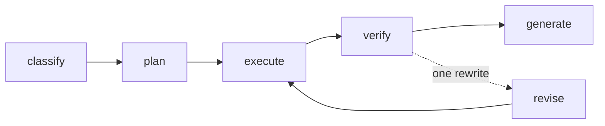
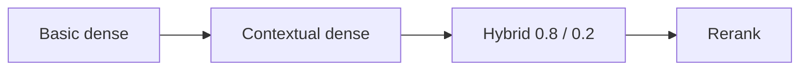
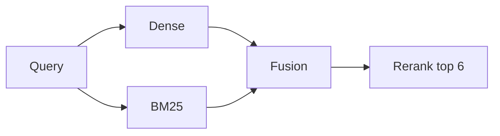
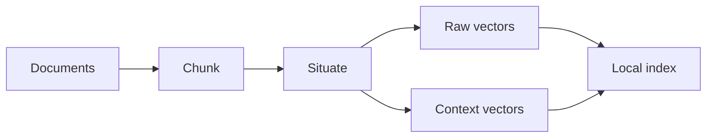

# Security Investigation Agent

A local agent for a fictional SaaS company. It answers security questions from a seeded record. It does not scan or change a real environment.

SQLite is the authority for incident status. Status at a time is replayed from `incident_events`, not copied from a similar document. A local Qwen model writes each chunk's situating sentence once, and writes the final reply only from incidents the tools already returned.

The company has six services (`auth-service`, `api-gateway`, `billing-service`, `user-service`, `admin-service`, `file-service`), 90 days of history, and planted cases for a resolved bug, an open bug, a reopened bug, a blocked attempt, and a lookalike alert. Knowledge briefs are short notes attributed to OWASP Top 10:2025, OWASP WSTG 4.2, and CWE. The agent does not read `data/scenarios/manifest.json`.

## Architecture

### Answer path

LangGraph in `agent.py`. Execute repeats until the plan is done or six tool steps are used. Verify replays `incident_events` up to the as-of time. Generate keeps the model text only when every incident it names already came back from a tool.



Each question class copies a fixed tool list. An unknown service name stops the plan before any tool runs.

| Class | When | Tools |
| --- | --- | --- |
| posture | Current incidents and alerts | `search_incidents`, `search_alerts` |
| historical | Was, previously, or a past date | `search_incidents`, `get_incident_history` |
| explanation | CWE, OWASP, or what causes something | `search_knowledge` |
| similar | Have we seen this before | `search_knowledge`, `search_incidents`, `search_alerts` |
| temporal | This week, changed, compared | `search_incidents`, `search_alerts`, `search_logs` |
| alert_review | Blocked, false positive, or a real vulnerability | `search_alerts`, `search_logs`, `search_incidents` |

Read-only tools time out at 30 seconds: `search_incidents`, `search_alerts`, `search_logs`, `get_incident_history`, and `search_knowledge`.

### Scored retrieval order

`notebooks/contextual_rag_01.ipynb` runs these stages on the same questions. Pass@k is 1 when the golden chunk is inside the top k. Questions name a service and a status, and they do not quote the incident title.



Basic dense embeds the raw chunk. Contextual dense embeds the situating sentence, then the chunk. Hybrid searches that same text with BM25 and blends the rankings (dense 0.8, BM25 0.2). Rerank scores the wide hybrid list and keeps the top k.

### Live search

`search_knowledge` uses the last two stages. It embeds the query once, reads the contextual dense index and BM25 together, and blends them by reciprocal rank. The cross-encoder rescores a pool of 150 and keeps 6. That score is a rank, not a probability.



Query vectors use the prefix `Represent this sentence for searching relevant passages: `. The reranker passage is the title, the situating sentence, and the chunk.

### How a chunk is indexed

`scripts/index_documents.py` chunks each document, asks `qwen3:8b` for one situating sentence, and embeds both views with `BAAI/bge-small-en-v1.5` (384 dimensions). The sentence is reused when the chunk text has not changed. Namespaces are `knowledge`, `incidents`, and `alerts`.



Chunks target about 400 tokens and stop at 500. The reranker is `cross-encoder/ms-marco-MiniLM-L6-v2`. Both models download on first use.

## Try it

You need Python 3.12 and [uv](https://docs.astral.sh/uv/). Ollama is required only when you index chunks or want Qwen to write the reply. Status questions are answered from SQLite without it.

### Install and seed

```bash
uv sync
cp .env.example .env
uv run python scripts/seed_database.py
```

`seed_database.py` writes `data/security.db` and `data/scenarios/manifest.json`, then returns. The reference time in `.env` is `2026-10-11T00:00:00Z`.

### Ask a status question

This plan reads incidents and alerts. It does not load the embedding model.

```bash
uv run python - <<'PY'
import asyncio
from pathlib import Path

from security_investigator.agent import InvestigationDeps, investigate
from security_investigator.config import get_settings

settings = get_settings()

async def main() -> None:
    result = await investigate(
        "Which critical incidents are active?",
        deps=InvestigationDeps(
            database_path=Path(settings.database_path),
            settings=settings,
        ),
    )
    print(result.answer)
    for finding in result.findings:
        print(f"incident {finding.incident_id}: {finding.status} ({finding.severity})")

asyncio.run(main())
PY
```

Other questions that stay on SQLite:

- `Was the billing SQL injection still active on 2026-08-11?`
- `Is the auth-service session revocation incident resolved?`
- `Was the file-service bucket policy change verified?`

### Index, then ask a retrieval question

Start Ollama and pull the situating model:

```bash
ollama pull qwen3:8b
```

`OLLAMA_BASE_URL` defaults to `http://127.0.0.1:11434`. Indexing is the slow step: one local model call per new chunk, eight at a time.

```bash
uv run python scripts/index_documents.py --limit 8
```

`--limit 8` situates the first 8 chunks so you can see that finish. Omit `--limit` to index every chunk. Output lands in `data/indexes/` (`chunks.jsonl`, `basic_embeddings.json`, `contextual_embeddings.json`).

Explanation and similarity questions call `search_knowledge`, so they need that index. Load the contextual vectors and ask:

```bash
uv run python - <<'PY'
import asyncio
from pathlib import Path

from security_investigator.agent import InvestigationDeps, investigate
from security_investigator.config import get_settings
from security_investigator.llm import answer_model_from_settings
from security_investigator.preprocess import (
    load_local_chunks,
    load_vectors,
    sentence_transformer_embedder,
    vectors_for_chunks,
)
from security_investigator.retrieval import BM25Index, MemoryDenseIndex

settings = get_settings()
index_dir = Path("data/indexes")
chunks = load_local_chunks(index_dir)
vectors = load_vectors(index_dir / "contextual_embeddings.json")
dense = MemoryDenseIndex()
grouped = vectors_for_chunks(chunks, vectors, dimension=settings.embedding_dimension)
for namespace, rows in grouped.items():
    dense.upsert(namespace, rows)

async def main() -> None:
    result = await investigate(
        "What is CWE-89?",
        deps=InvestigationDeps(
            database_path=Path(settings.database_path),
            settings=settings,
            embedder=sentence_transformer_embedder(settings.embedding_model),
            index=dense,
            chunks=chunks,
            bm25_index=BM25Index(chunks),
            answer_model=answer_model_from_settings(settings),
        ),
    )
    print(result.answer)
    for pair in result.chunk_pairs:
        print(pair.chunk_id, pair.summary)

asyncio.run(main())
PY
```

With only 8 chunks indexed, `What is CWE-89?` can miss its note. Drop `--limit` before you judge retrieval. Set `LOCAL_SUMMARIZER_ENABLED=false` if you want the deterministic draft and no final Qwen call.

### Score retrieval

Run `notebooks/contextual_rag_01.ipynb` from the project root. The first cell indexes 145 documents and shows a tqdm bar while Qwen writes each situating sentence. The next cells print Pass@5, Pass@10, and Pass@20 for basic dense, contextual dense, contextual BM25 hybrid, and rerank. Raise `DOCUMENT_LIMIT` in that first cell for a larger set. A later cell calls the agent and prints the SQLite status. It does not score the agent. Ollama must be running with `qwen3:8b`.

## Checks

```bash
uv run pytest
```
